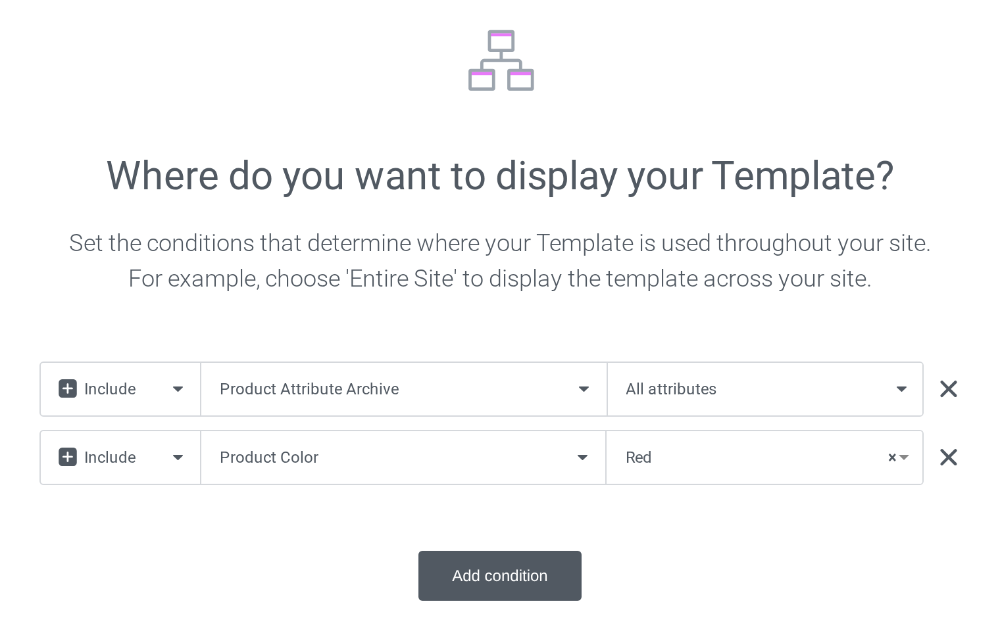
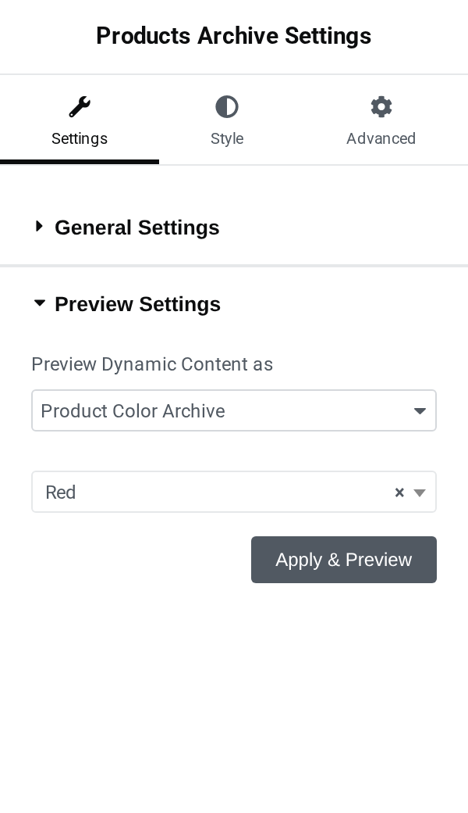

# Elementor Attribute Condition

A small WordPress plugin that makes WooCommerce product attribute archives (Material, Designer, Author, Color...) first-class citizens in the Elementor Pro Theme Builder.

Out of the box, Elementor Pro lets you target a Product Archive template at product categories and tags, but not at attribute archives such as `/color/red/`. They are also missing from the "Preview Dynamic Content as" list in the editor, so you cannot design an attribute archive template against real data.

## When it is useful

Whenever an attribute is a thing people browse by, and its archive deserves its own page rather than a generic product list:

- **People**: the teacher of a course, the author of a book, the designer of a piece, with photo and bio from ACF fields on the term.
- **Origins**: the region or producer of a wine or food product, with a map or a story.
- **Landing pages**: a color or material archive with its own intro text, for search engines.

Brands are no longer the typical case: WooCommerce 9.6 added a native Brands taxonomy, which Elementor Pro already supports.

## Why they are missing

WooCommerce registers attribute taxonomies with `show_in_nav_menus` set to `false`, even when "Enable archives" is ticked. Elementor Pro builds its lists of conditions, preview options and dynamic tag taxonomies only from taxonomies that have it set to `true`. That one flag is the whole gap.

WooCommerce provides a filter for it, `woocommerce_attribute_show_in_nav_menus`. This plugin turns it on for attributes that have archives enabled, and Elementor Pro does the rest with its own code: no overridden document classes, no rewritten queries. The one addition is a few lines of editor script for the preview, described below.

## What you get

Under **Theme Builder → Product Archive → Display Conditions → Include → Product Archive**:

- **Each attribute by name** (e.g. *Color*), with Elementor's own term picker: all Color archives, or only *Red*. This is Elementor Pro's native taxonomy condition.
- **Product Attribute Archive**: the archive of any attribute, for a single template shared by all attribute archives. It also lets you pick one attribute, which is the same as the native condition above without a term: that option is kept so that templates saved with version 1.x keep working.



In the editor, **Preview Dynamic Content as** lists each attribute archive. Elementor Pro can preview a specific term of a taxonomy archive, but its editor only shows the term field for Loop templates, so archive templates always preview the first term. The plugin shows that field for every taxonomy archive preview (attributes, and also other taxonomies such as product categories), as a search on the terms of that taxonomy. Dynamic tags that read the current archive (Archive Title, Archive Description, ACF fields on terms) show the chosen term's data.



Attributes also become available wherever Elementor Pro lists product taxonomies, such as the **Product Terms** dynamic tag and the taxonomy filters of the Posts widget.

## Requirements

- WordPress 6.5 or later
- PHP 7.4 or later
- Elementor and Elementor Pro (tested with 4.4)
- WooCommerce (tested with 11.2)

Only attributes with **Enable archives** ticked (Products → Attributes → Edit) are affected. An attribute without archives has no archive page to template.

## Installation

1. Download the repository as a ZIP, or clone it into `wp-content/plugins/elementor-attribute-condition`.
2. Activate **Elementor Attribute Condition**. WordPress refuses to activate it until Elementor, Elementor Pro and WooCommerce are active. WordPress matches dependencies by folder name: Elementor Pro must be installed in `wp-content/plugins/elementor-pro`.
3. Go to **Templates → Theme Builder**, add or edit a **Product Archive** template, and choose a condition as described above.

There are no settings.

## Side effect: Appearance → Menus

`show_in_nav_menus` is also what WordPress uses to offer a taxonomy in the menu editor, so each attribute with archives becomes available as a box under **Appearance → Menus** (hidden by default; enable it from **Screen Options**). This is harmless and sometimes useful, but if you want a specific attribute left out of everything, including Elementor, use the filter:

```php
add_filter( 'elementor_attribute_condition_expose_attribute', function ( $expose, $taxonomy ) {
	return 'pa_internal_code' === $taxonomy ? false : $expose;
}, 10, 2 );
```

## Limits

- Elementor Pro reads the flag when it builds its lists, so the behaviour depends on Elementor Pro keeping that logic. The term field in the preview wraps an internal function of the Elementor Pro editor (`updatePreviewIdOptions`): if a release renames it, the field disappears again and archive templates preview the first term, nothing breaks. Test after major Elementor Pro releases.
- **Loop Items and Loop Grids** do not need this plugin: Elementor Pro already offers attribute taxonomies as the source of taxonomy Loop Items and Loop Grids, with the term picker in the preview (checked with Elementor Pro 4.4, with and without this plugin). It excludes `pa_color` and `pa_size` by name, and this plugin cannot change that.
- If an attribute used in a "Product Attribute Archive" condition is renamed or deleted, the condition keeps pointing to the old taxonomy and matches nothing, while the conditions screen shows "All attributes". Set the condition again after renaming an attribute.
- Elementor Pro only uses the flag where it uses it: this plugin does not add attributes to places where Elementor Pro lists taxonomies in another way.

## Upgrading from 1.x

Version 2.0 replaces the 1.x internals (a custom Product Archive document class, query rewrites in the editor, a filter on post meta) with Elementor Pro's native handling.

- **Display conditions saved with 1.x keep working**: the "Product Attribute Archive" condition keeps its internal name.
- **Preview settings saved with 1.x are converted once**, the first time an administrator loads an admin page after the update, with WooCommerce active: 1.x stored the term inside the preview type (`taxonomy/pa_color::red`), Elementor Pro wants the attribute archive plus the term ID. The plugin stores its version in the option `elementor_attribute_condition_version`, removed when the plugin is deleted. A setting whose attribute or term no longer exists is left as it is, and the template previews the first term.
- The helper functions `get_current_loop_term()` and `get_loop_term_meta()` are gone. Read term fields from the queried object instead, e.g. `get_term_meta( get_queried_object_id(), 'key', true )`.

## License

GPL-2.0-or-later. See [LICENSE](LICENSE).

## Author

Diego Vagnoli, [diegovagnoli.it](https://diegovagnoli.it)
